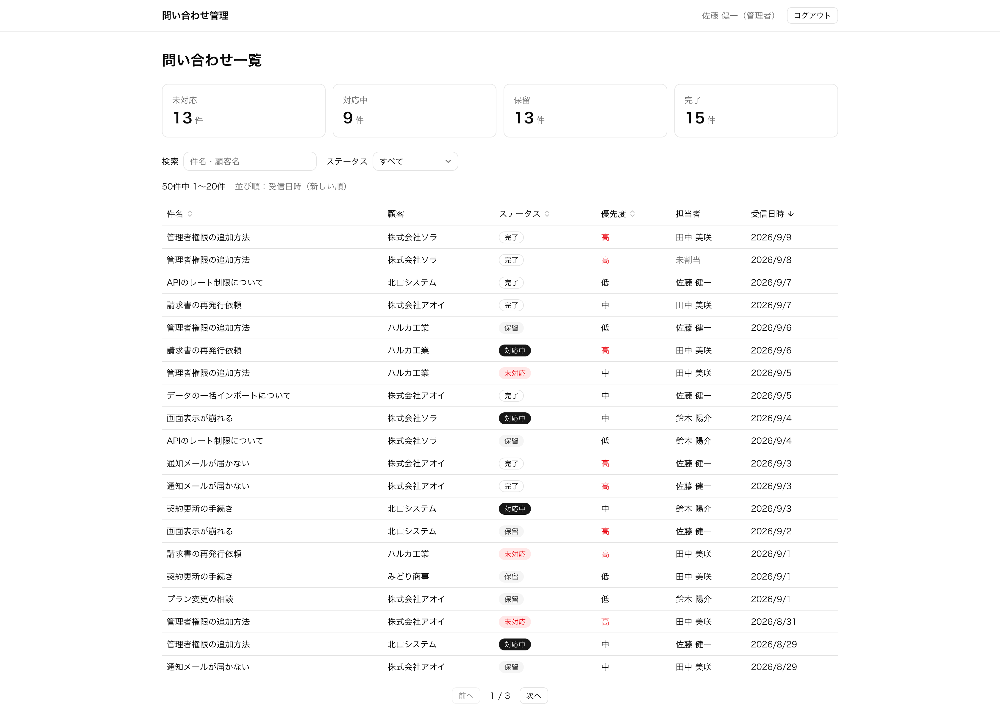
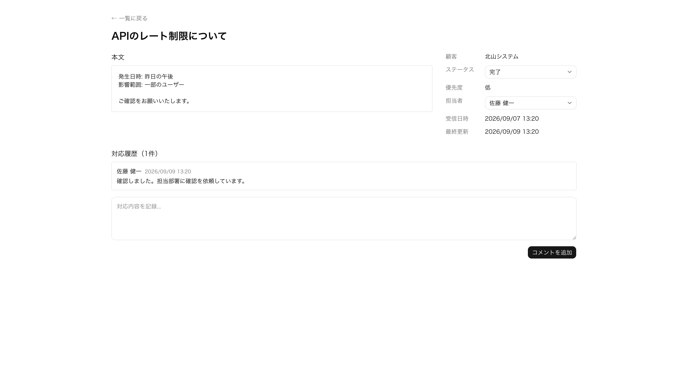
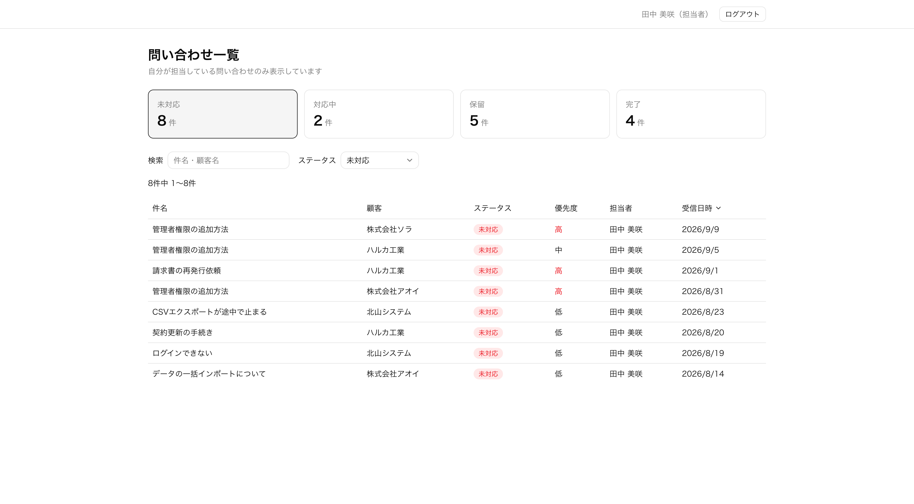

# 問い合わせ管理ダッシュボード

カスタマーサポート業務を想定した、社内向けの問い合わせ管理画面です。

**デモ**: https://contact-dashboard-app-neon.vercel.app

ログイン画面の「管理者でログイン」「担当者でログイン」ボタンから、入力なしで試せます。

| ロール | メールアドレス     | パスワード | 閲覧・操作できる範囲             |
| ------ | ------------------ | ---------- | -------------------------------- |
| 管理者 | admin@example.com  | demo1234   | すべての問い合わせ               |
| 担当者 | member@example.com | demo1234   | 自分が担当している問い合わせのみ |

## 概要

単純な CRUD で終わらないよう、次の要素を含む題材を選びました。

- ステータスの変更に業務上の制約がある（一度対応した問い合わせは「未対応」に戻せない）
- ロールによって閲覧・操作できる範囲が変わる
- 件数が増えても、検索・絞り込み・並び替えを快適に行える必要がある

管理画面で求められる設計上の判断を、実装しながら検討しました。
主な判断とその理由は [設計判断](#設計判断) にまとめています。

- **データアクセス層（DAL）を作成**し、認証・権限チェックをそこに集約
- **検索・絞り込み・並び替え・ページ分けをデータベース側で処理**し、表示中のページの分だけを取得
- **一覧の表示条件を URL に持たせ**、リロードやブラウザバック、URL の共有でも同じ表示を再現
- **ステータス・担当者の変更履歴を自動で記録**し、記録漏れを防止

## 画面

**一覧（管理者）**


**詳細**


**一覧（担当者）** — 自分が担当する問い合わせのみ表示


## 主な機能

**問い合わせ管理**

- 一覧表示（件名・顧客名での検索、ステータスでの絞り込み、並び替え、ページネーション）
- ステータス別の件数サマリー
- 詳細表示
- ステータスの変更（遷移ルールあり。管理者はルールを迂回可能）
- 担当者の割り当て・引き継ぎ
- 対応履歴（コメントと、ステータス・担当者の変更履歴を時系列で表示）

**認証・権限**

- メールアドレスとパスワードによる認証
- ロールによる閲覧範囲・操作範囲の制御

**UI**

- ステータス・担当者の変更は楽観的更新（`useOptimistic`）で即時反映し、失敗時は元に戻す
- 件数サマリーと一覧を Suspense で分割し、読み込み中はスケルトンを表示
- 「本文へスキップ」リンク、スクリーンリーダー向けの絞り込み条件・表示範囲の読み上げ

## 技術スタック

| 分類           | 使用技術                                          |
| -------------- | ------------------------------------------------- |
| フレームワーク | Next.js 16（App Router）                          |
| 言語           | TypeScript 5                                      |
| UI             | React 19 / Tailwind CSS v4 / shadcn/ui（Base UI） |
| ORM            | Prisma 7                                          |
| データベース   | Neon（PostgreSQL）                                |
| 認証           | Better Auth 1.7                                   |
| ホスティング   | Vercel                                            |

## ディレクトリ構成

```
src/
├── app/
│   ├── (dashboard)/  ログインが必要な画面（一覧・詳細）と共通レイアウト
│   ├── actions/      Server Actions（入力を検証し、data/ を呼び出す）
│   ├── login/
│   └── signup/
├── data/             データアクセス層（認証・権限チェックと DB クエリ）
├── lib/              ステータス遷移ルール、URL パラメータの検証、表示ラベルなど
└── components/       UI コンポーネント
prisma/               スキーマ・マイグレーション・シード
```

## 設計判断

### ステータス遷移ルールを検討して1つに絞った

問い合わせのステータス遷移には制約を設けているが、最終的に禁止しているのは「未対応（`OPEN`）への巻き戻し」のみ。

当初は「未対応 → 対応中 → 完了」の直線的な遷移だけを許可していた。
しかし実際のサポート業務では次のような操作が必要になるため、制約を外した。

- 即答できる問い合わせを、対応中を経由せず完了にする
- 完了後に「解決していない」と返信が来て再オープンする
- 再オープン後、他部署の対応待ちで保留にする

**未対応への巻き戻しだけを禁止**

未対応は「まだ誰も手を付けていない」という意味を持つ。
作業を止める場合は保留があるため、未対応に戻す必要はない。
未対応に戻せないことで、放置されている問い合わせの件数を正確に把握できる。

**管理者はルールを迂回できる**

操作ミスは必ず起きるため、管理者は遷移ルールに関係なくステータスを変更できる。
普段の操作はルールで制限し、間違えたときは管理者が直せるようにしている。

### 検索・絞り込みの状態を URL に持たせた

一覧の検索・絞り込み・並び替え・ページ番号は、すべて URL（`searchParams`）だけで管理している。
コンポーネント側は状態を持たず、URL を読んで表示するだけの構造にした。

URL で管理したのは、管理画面では次のことが求められるため。

- 絞り込んだ結果の URL をそのまま共有できる
- ブラウザバックで前の絞り込み状態に戻れる
- リロードしても条件が消えない

よくある `useState` で条件を持つ方法では、これらがすべて実現できない。
加えて、状態がサーバーに届くため Server Component 内で直接クエリの条件として使える。

**例外**

検索入力欄だけは、入力中の文字を URL ではなく入力欄自体（`defaultValue` を使った非制御コンポーネント）に持たせている。
1文字ごとに URL を更新するとリクエストが飛びすぎるため、300ms のデバウンスを挟んでから URL に反映している。

### 権限チェックをデータアクセス層に集約した

認証・権限の確認は、`src/data/` にまとめたデータアクセス層（DAL）の関数の中で行っている。
画面や Server Actions は DB に直接アクセスせず、必ずこの層を経由する。

Next.js の公式ドキュメントでも、認証・権限の確認はデータアクセス層で行うことが推奨されている。
実際にデータを取得する関数の中で確認すれば、どの経路から呼ばれても権限チェックが必ず走る。
Server Actions は公開エンドポイントと同等に扱う必要があるため、クライアント側の制限だけに依存しない構造にしている。

**ロールはクライアントから設定できない**

Better Auth の `additionalFields` で `role` に `input: false` を指定している。
これがないと、サインアップのリクエストに `role: "ADMIN"` を含めるだけで管理者アカウントを作成できてしまう。
新規登録したユーザーは担当者になり、管理者はシードでのみ作成している。

### 担当を引き継いだ直後に 404 にしない

担当者が自分以外に担当を引き継ぐと、その問い合わせは閲覧できなくなる。
更新後にそのまま詳細ページを表示し直すと 404 画面になり、引き継ぎに失敗したように見えていた。

担当者の更新処理が「更新後も閲覧できるか」を返すようにし、閲覧できなくなる場合は表示し直さず、トーストで通知してから一覧に戻している。

### 変更履歴は更新と同じトランザクションで記録する

ステータスと担当者の変更は、`InquiryEvent` テーブルに「誰が・いつ・何から何に変えたか」を記録している。
問い合わせの更新と履歴の作成は 1 つのトランザクションで実行しているため、「値は変わったのに履歴が残っていない」状態にはならない。

変更前後の値は、種類ごとに型付きの列（`fromStatus` / `toStatus`、`fromAssigneeId` / `toAssigneeId`）で持っている。
担当者は外部キーで参照しているので、ユーザー名が変わっても履歴には現在の名前が表示される。

コメントと変更履歴は別のテーブルに保存し、詳細ページで時系列に並べて 1 つの対応履歴として表示している。

### DB に保存する値と画面の表示名を分けた

ステータスや優先度は DB に `IN_PROGRESS` のような英語の識別子で保存し、日本語ラベルは `src/lib/labels.ts` で対応表として持っている。

画面の表示名は後から変わることがあるが、識別子は変える必要がない。
DB に日本語の表示名をそのまま保存すると、文言を変えるたびに全レコードの更新が必要になる。
対応表は `Record<InquiryStatus, string>` で型付けしているため、ステータスを追加して対応表に書き忘れると、コンパイルエラーになる。

### URL パラメータはホワイトリストで検証している

URL は誰でも書き換えられるため、存在しない項目名（`?sort=xxx` など）が渡されることもある。
そのまま Prisma に渡すと、500 エラーになる。

そこで、`status` `sort` `order` は許可する値の一覧と照合し、`page` は1以上の整数かを確認している。
不正な値はエラーにせず、デフォルト値に戻す。
URL を打ち間違えただけでエラー画面になるより、初期状態の一覧が表示されるほうが使いやすいため。

## ローカルでの起動

PostgreSQL（Neon など）が必要です。

```bash
npm install
cp .env.example .env
npx prisma generate
npx prisma migrate deploy
npx prisma db seed
npm run dev
```

`.env` には以下を設定します。

| 変数                 | 内容                                                     |
| -------------------- | -------------------------------------------------------- |
| `DATABASE_URL`       | アプリが使う接続文字列（Neon の場合はプーリング接続）    |
| `DIRECT_URL`         | マイグレーション・シードが使う直接接続の接続文字列       |
| `BETTER_AUTH_SECRET` | `openssl rand -base64 32` などで生成したランダムな文字列 |
| `BETTER_AUTH_URL`    | `http://localhost:3000`                                  |

シードを実行すると既存のデータはすべて削除され、デモと同じアカウントでログインできる状態になります。

## 今後の課題

- ステータス遷移ルール・URL パラメータの検証・権限チェックの自動テストと、CI での実行
