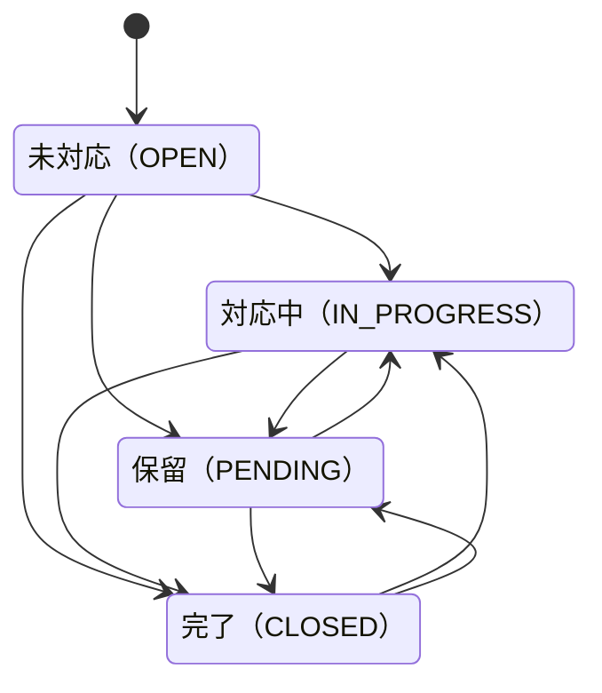

# 問い合わせ管理ダッシュボード

BtoB SaaS のカスタマーサポート業務を想定した、問い合わせ管理の社内向け管理画面です。

**デモ**: https://contact-dashboard-app-neon.vercel.app

ログイン画面の「管理者でログイン」「担当者でログイン」ボタンから、入力なしで試せます。

| ロール | メールアドレス     | パスワード | 閲覧・操作できる範囲             |
| ------ | ------------------ | ---------- | -------------------------------- |
| 管理者 | admin@example.com  | demo1234   | すべての問い合わせ               |
| 担当者 | member@example.com | demo1234   | 自分が担当している問い合わせのみ |

## 概要

単純な CRUD ではなく、以下を含む構造を実装することを目的に題材を選びました。

- ステータス遷移にドメインルールがある（完了から未対応には戻せない、など）
- ロールによって閲覧範囲と操作範囲が変わる
- 件数が増える前提で、検索・絞り込み・ソートをすべてサーバーサイドで処理する

実務の管理画面で必要になる判断を、実装を通して検討しています。
主な判断とその理由は [設計判断](#設計判断) にまとめています。

- **権限チェックをデータ取得関数の中に集約**し、middleware に依存しない
- **権限がない問い合わせは 404** にして、存在自体を推測させない
- **一覧の状態はすべて URL に持たせ**、共有・ブラウザバック・リロードに対応
- **ステータス遷移ルールは業務フローから検討**し、禁止は「未対応への巻き戻し」だけに絞った
- **ステータス・担当者の変更履歴**を、更新と同じトランザクションで自動記録

## 画面

**一覧（管理者）**


**詳細**


**一覧（担当者）** — 自分が担当する問い合わせのみ表示


## 主な機能

**問い合わせ管理**

- 一覧表示（件名・顧客名での検索、ステータスでの絞り込み、ソート、ページネーション）
- ステータス別の件数サマリー
- 詳細表示
- ステータスの変更（遷移ルールあり。管理者はルールを迂回可能）
- 担当者の割り当て・引き継ぎ
- 対応履歴（コメントと、ステータス・担当者の変更履歴を時系列で表示）

**認証・権限**

- メールアドレスとパスワードによる認証
- ロールによる閲覧範囲・操作範囲の制御

**UI**

- ステータス・担当者の変更は楽観的更新（`useOptimistic`）で即時反映し、失敗時は元に戻す
- 件数サマリーと一覧を Suspense で分割し、読み込み中はスケルトンを表示
- エラー画面に再試行ボタンと、サーバーログと照合するためのエラー ID を表示
- 「本文へスキップ」リンク、スクリーンリーダー向けの絞り込み条件・表示範囲の読み上げ

## 技術スタック

| 分類           | 使用技術                                          |
| -------------- | ------------------------------------------------- |
| フレームワーク | Next.js 16（App Router）                          |
| 言語           | TypeScript 5                                      |
| UI             | React 19 / Tailwind CSS v4 / shadcn/ui（Base UI） |
| ORM            | Prisma 7                                          |
| データベース   | Neon（PostgreSQL）                                |
| 認証           | Better Auth 1.7                                   |
| ホスティング   | Vercel                                            |

## ディレクトリ構成

```
src/
├── app/
│   ├── (dashboard)/  ログインが必要な画面（一覧・詳細）と共通レイアウト
│   ├── actions/      Server Actions（入力を検証し、data/ を呼び出す）
│   ├── login/
│   └── signup/
├── data/             データアクセス層（認証・権限チェックと DB クエリ）
├── lib/              ステータス遷移ルール、URL パラメータの検証、表示ラベルなど
└── components/       UI コンポーネント（ui/ は shadcn/ui）
prisma/               スキーマ・マイグレーション・シード
```

## 設計判断

### 検索・絞り込みの状態を URL に持たせた

一覧の検索・絞り込み・ソート・ページ番号は、すべて `searchParams` を単一の状態源としている。
コンポーネント側は状態を持たず、URL を読んで表示するだけの構造にした。

管理画面では以下が実際の業務要件になるため。

- 絞り込んだ結果の URL をそのまま共有できる
- ブラウザバックで前の絞り込み状態に戻れる
- リロードしても条件が消えない

`useState` で持つとこれらが全部失われる。加えて、状態がサーバーに届くため
Server Component 内で直接クエリの条件として使える。

**踏んだ問題**

検索・絞り込み時にページ番号をリセットする処理が必要だった。
3ページ目で検索すると `?q=xxx&page=3` になり、ヒットが2件でも3ページ目は空になる。
ユーザーからは「検索したのに何も出ない」ように見える。

**例外**

検索入力欄だけは `defaultValue` を使い、React 側で入力値を保持していない。
1文字ごとに URL を更新するとリクエストが飛びすぎるため、
300ms のデバウンスを挟んでから URL に反映している。

当初は `useEffect` で実装したが、依存配列に `searchParams` を含めた結果、
`router.push` が `searchParams` を変更して `useEffect` が再発火する無限ループになった。
入力ハンドラ内で `setTimeout` を直接管理する形に変更している。

### 権限チェックを Data Access Layer に集約した

認証・権限の確認は `src/data/` 配下のデータアクセス関数の中で行っている。
middleware では行っていない。

2025年3月に公開された CVE-2025-29927 により、
`x-middleware-subrequest` ヘッダーの偽装で middleware を迂回できることが示された。
Next.js 側で修正済みだが、middleware は構造的に「最初の防波堤」でしかない。

実際にデータを取得する関数の中で確認すれば、
どの経路から呼ばれても権限チェックが必ず走る。
Server Actions は公開エンドポイントと同等に扱う必要があるため、
クライアント側の制限だけに依存しない構造にしている。

**権限がない場合は 404 を返す**

他人が担当する問い合わせの詳細 URL を直接開いた場合、403 ではなく 404 になる。
「存在するが権限がない」と分かると、ID を変えながら試すことで
他の問い合わせの存在を推測できるため。
データ取得関数は「存在しない場合」と「権限がない場合」の両方で `null` を返し、
呼び出し側から区別できないようにしている。

**ロールはクライアントから設定できない**

Better Auth の `additionalFields` で `role` に `input: false` を指定している。
これがないと、サインアップのリクエストに `role: "ADMIN"` を含めるだけで
管理者アカウントを作成できてしまう。
ロールの変更はサーバー側の経路に限定している。

**担当を引き継いだ直後に 404 にしない**

担当者が自分以外に担当を引き継ぐと、その問い合わせは閲覧できなくなる。
更新後にいつも通り詳細ページを再検証すると、表示中のページが再描画されて
404 になり、引き継ぎに失敗したように見えていた。

担当者の更新処理が「更新後も閲覧できるか」を返すようにし、
閲覧できなくなる場合は再検証せず、トーストで通知してから一覧に戻している。

### ステータス遷移ルールを検討して1つに絞った

問い合わせのステータス遷移には制約を設けているが、
最終的に禁止しているのは「OPEN への巻き戻し」のみ。



当初は `OPEN → IN_PROGRESS → CLOSED` の直線的な遷移だけを許可していた。
しかし実際のサポート業務を検討すると、以下が発生する。

- 即答できる問い合わせを、対応中を経由せず完了にする
- クローズ後に「解決していない」と返信が来て再オープンする
- 再オープン後、他部署の対応待ちで保留にする

これらを禁止すると、実務では中間ステータスを一瞬経由するだけの
無意味な操作を強いることになるため、制約を外した。

**OPEN への巻き戻しだけを禁止した理由**

OPEN は「まだ誰も対応していない」という意味を持つ。
ここに戻せると未対応件数が信用できなくなり、
ダッシュボードの指標として機能しなくなる。
再オープン時は OPEN ではなく IN_PROGRESS に戻すことで、
新規の問い合わせと区別している。

**管理者はルールを迂回できる**

操作ミスは必ず発生するため、管理者ロールは遷移ルールの検証を通らない。
業務フローは制約で守り、例外は権限で解決する、という切り分けにしている。

### 変更履歴は更新と同じトランザクションで記録する

ステータスと担当者の変更は、`InquiryEvent` テーブルに「誰が・いつ・何から何に変えたか」を記録している。
問い合わせの更新と履歴の作成は 1 つのトランザクションで実行しているため、
「値は変わったのに履歴が残っていない」状態にはならない。
値が変わらない操作（同じステータスを選び直すなど）は履歴に残さない。

変更前後の値は、種類ごとに型付きの列（`fromStatus` / `toStatus`、`fromAssigneeId` / `toAssigneeId`）で持っている。
担当者は外部キーで参照しているので、ユーザー名が変わっても履歴には現在の名前が表示される。

コメントと変更履歴は別のテーブルに保存し、詳細ページで時系列に並べて 1 つの対応履歴として表示している。

### enum は英語で定義し、表示ラベルを分離した

ステータスや優先度は DB に `IN_PROGRESS` のような英語の識別子で保存し、
日本語ラベルは `src/lib/labels.ts` で対応表として持っている。

表示名は変わりうるが、識別子は変わらない。同居させると、
文言変更のたびに全レコードの更新が必要になる。
対応表は `Record<InquiryStatus, string>` で型付けしているため、
enum に値を追加するとラベル未定義がコンパイルエラーになる。

### enum の定義順がソート順を決めている

`Priority` は `LOW, MEDIUM, HIGH` の順に定義している。
PostgreSQL の enum は定義順で比較されるため、降順にすると「優先度が高い順」になる。
`InquiryStatus` も対応フローの順序で定義しており、
昇順で「未対応が先」になるよう揃えた。

### 検索対象の列にインデックスを貼っていない

件名の検索は部分一致（`LIKE '%xxx%'`）のため、通常の B-tree インデックスが効かない。
貼っても書き込みコストが増えるだけなので、意図的に貼っていない。

件数が増えた場合は pg_trgm による GIN インデックス、
または全文検索への切り替えが必要になる。現状のデータ量では不要と判断した。

一方、絞り込みに使う列には複合インデックス `[status, createdAt]` を貼っている。
等価比較する列を先、並び替えに使う列を後に置くことで、
「ステータスで絞って日時順に並べる」という最頻出のクエリを1本でカバーしている。

### URL パラメータはホワイトリストで検証している

`status` `sort` `order` `page` は、許可する値を列挙して照合し、
一致しない場合はデフォルト値にフォールバックする。

`?sort=xxx` のような値をそのまま Prisma に渡すと 500 エラーになる。
URL は誰でも書き換えられるため、外部入力として扱っている。

エラー画面を出さずデフォルトに倒しているのは、
URL の打ち間違いで画面が壊れるより、絞り込みが効いていない状態のほうが
管理画面として実用的なため。

### TanStack Table を導入していない

shadcn/ui の Data Table は TanStack Table を前提としているが、採用していない。

ソート・フィルタ・ページネーションはすべてサーバーサイドで実装しており、
導入すると `manualPagination` `manualSorting` `manualFiltering` で
主要機能をすべて無効化することになる。

列の表示切り替えや行選択が必要になった時点で再検討する。

## ローカルでの起動

PostgreSQL（Neon など）が必要です。

```bash
npm install
cp .env.example .env
npx prisma migrate deploy
npx prisma db seed
npm run dev
```

`.env` には以下を設定します。

| 変数                 | 内容                                                     |
| -------------------- | -------------------------------------------------------- |
| `DATABASE_URL`       | アプリが使う接続文字列（Neon の場合はプーリング接続）    |
| `DIRECT_URL`         | マイグレーション・シードが使う直接接続の接続文字列       |
| `BETTER_AUTH_SECRET` | `openssl rand -base64 32` などで生成したランダムな文字列 |
| `BETTER_AUTH_URL`    | `http://localhost:3000`                                  |

シードを実行すると既存のデータはすべて削除され、デモと同じアカウントで
ログインできる状態になります。

## 今後の課題

- ステータス遷移ルール・URL パラメータの検証・権限チェックの自動テストと、CI での実行
- 複数人が同時に同じ問い合わせを更新したときの検知（楽観的ロック）
- 件数が増えた場合の件名検索の高速化（pg_trgm による GIN インデックス）
